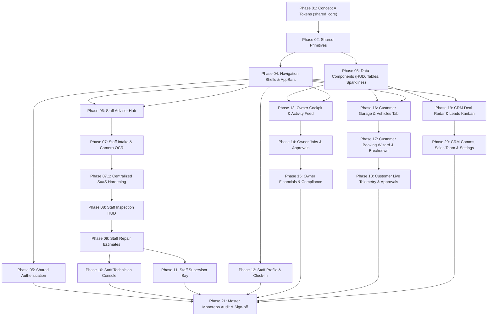

# Redesign v2 Implementation Architecture & Roadmap Master Hub

**Root Location:** `phases/redesign_v2/`  
**Target Visual Identity:** **Concept A — Premium Minimal Automotive** (Approved by Product Owner)  
**Execution Status:** PHASE 01 COMPLETE (Engineering Passed; Visual Gate Pending Product Owner) + PHASE 01.1 COMPLETE (Centralized Theme Architecture Correction). PHASE 02 work-in-progress present in the tree; **not started/signed off by this pass**.
**Strategy Document Version:** 2.1.0-PROD (Final Reconciled & Split Roadmap)  
**Author:** Principal Product Designer, Systems Architect & Lead Flutter Engineer  

---

## 1. Executive Mission & Authority

On October 14, 2026, **Concept A — Premium Minimal Automotive** was officially approved as the sole design authority for the Orient Workshop Flutter monorepo. Concepts B and C were rejected. The previous visual direction established during Phases 00–07A is formally superseded for all visual design purposes.

This directory contains the **complete, production-grade, ground-up UI/UX implementation roadmap** for resetting every screen, route, and widget across the entire monorepo:
1. **`staff_app`**: Workshop operations (Advisor, Supervisor, Technician, Vehicle Intake, Inspection HUD).
2. **`owner_app`**: Business intelligence, executive cockpit, floor occupancy, revenue velocity, and compliance.
3. **`customer_app`**: Consumer digital garage, live telemetry tracking, guided booking wizard, and estimates.
4. **`crm_app`**: Deal pipeline, lead radar, omnichannel conversations, and conversion metrics.
5. **Shared Packages**: `shared_core`, `shared_auth`, `app_router`, and domain entities.

```
┌────────────────────────────────────────────────────────────────────────┐
│                    ORIENT REDESIGN V2 SCOPE AT A GLANCE                │
├────────────────────────────────────────┬───────────────────────────────┤
│ Selected Visual Direction              │ Concept A (Premium Minimal)   │
│ Production Applications                │ 4 Production Apps             │
│ Shared Foundation Packages             │ 3 Shared Packages             │
│ Total Unique Named Routes Mapped       │ 52 Routes                     │
│ Total Primary Screens & Shell Tabs     │ 67 Primary Surfaces           │
│ Total Standalone Sheets & Dialogs      │ 19 Secondary Surfaces         │
│ Total Reconciled UI Surfaces           │ 86 Total Surfaces (100% Mapped│
│ Core Shared Widgets Audited & Classified│ 42 Components                 │
│ Total Execution Phases (Post-Split)    │ 21 Dedicated Codex Phases     │
│ Localization Parity                    │ 100% Bilingual (EN LTR/AR RTL)│
│ Production UI Status                   │ 0 Lines Modified (Frozen Gate)│
└────────────────────────────────────────┴───────────────────────────────┘
```

---

## 2. Directory Structure & Document Navigation

```text
phases/redesign_v2/
│
├── README.md                               <- You are here: Master index & execution roadmap
├── 00_CONCEPT_A_APPROVAL.md                <- Formal PO sign-off & visual authority declaration
├── 00_CONCEPT_A_DESIGN_SYSTEM.md           <- Full token, color, typography, radius & elevation spec
├── 00_COMPLETE_SCREEN_INVENTORY.md         <- Exhaustive catalog of all 67 screens & 19 sheets/dialogs
├── 00_COMPLETE_WIDGET_INVENTORY.md         <- Action matrix for all 42 shared & feature widgets
├── 00_FEATURE_CAPABILITY_VERIFICATION.md   <- 4-tier capability audit (Tier 1-3 enabled, Tier 4 deferred)
├── 00_RESPONSIVE_RTL_SPEC.md               <- Breakpoints (320-1440px) & bilingual Arabic mirroring rules
├── 00_SCREEN_ARCHETYPES.md                 <- 11 dedicated purpose-built layout archetypes
├── 00_COVERAGE_MATRIX.md                   <- 100% monorepo screen-to-phase allocation matrix
├── 00_PHASE_DEPENDENCIES.md                <- Strict DAG dependency graph & critical path
├── 00_VISUAL_ACCEPTANCE_RULES.md           <- Non-negotiable visual & engineering quality gates
│
├── discovery/                              <- Stage A discovery outputs (10 historical audit files)
│   ├── 01_COMPLETE_PROJECT_INVENTORY.md
│   ├── ...
│   └── 10_VISUAL_COMPARISON_AND_RECOMMENDATION.md
│
├── implementation/                         <- Phase-by-phase executable Codex implementation prompts
│   ├── PHASE_01_DESIGN_SYSTEM_TOKENS.md
│   ├── PHASE_02_SHARED_PRIMITIVES.md
│   ├── PHASE_03_COMPLEX_DATA_COMPONENTS.md
│   ├── PHASE_04_NAVIGATION_SHELLS.md
│   ├── PHASE_05_AUTHENTICATION_FLOWS.md
│   ├── PHASE_06_STAFF_ADVISOR_HUB.md
│   ├── PHASE_07_STAFF_VEHICLE_INTAKE.md
│   ├── PHASE_07_1_CENTRALIZED_SAAS_HARDENING.md
│   ├── PHASE_08_STAFF_INSPECTION_HUD.md
│   ├── PHASE_09_STAFF_REPAIR_ESTIMATES.md
│   ├── PHASE_10_STAFF_TECHNICIAN_CONSOLE.md
│   ├── PHASE_11_STAFF_SUPERVISOR_BAY.md
│   ├── PHASE_12_STAFF_COMMON_PROFILE.md
│   ├── PHASE_13_OWNER_COCKPIT_OPERATIONS.md
│   ├── PHASE_14_OWNER_JOBS_APPROVALS.md
│   ├── PHASE_15_OWNER_FINANCIALS_COMPLIANCE.md
│   ├── PHASE_16_CUSTOMER_GARAGE_HOME.md
│   ├── PHASE_17_CUSTOMER_BOOKING_WIZARD.md
│   ├── PHASE_18_CUSTOMER_STATUS_APPROVALS.md
│   ├── PHASE_19_CRM_DEAL_RADAR_PIPELINE.md
│   ├── PHASE_20_CRM_COMMS_TEAM_OPS.md
│   └── PHASE_21_FINAL_MONOREPO_AUDIT.md
│
└── reports/                                <- Completion reports generated at the end of each phase
```

---

## 3. High-Level Phase Overview & Dependency Pipeline

The implementation is structured into **22 tightly scoped, sequentially gated phases**. Oversized phases from the initial draft (Staff Tech/Supervisor, Owner Financials, Customer Booking/Tracking, CRM Pipeline) have been split into independent, verified execution packages.



---

## 4. Execution Rules for Codex Engineers

1. **Standalone Execution**: Each prompt in `phases/redesign_v2/implementation/PHASE_*.md` is completely self-contained. It details exact file paths, existing behaviors, Concept A visual requirements, responsive rules, test assertions, and screenshot generation requirements.
2. **Zero Functional Regressions**: Riverpod state notifiers, Hive offline storage, Dio network interceptors, and GoRouter routes must be preserved with 100% fidelity. Functional preservation does not mean visual preservation.
3. **No Phantom Approvals**: A phase is NOT complete just because `dart analyze` passes. Every phase mandates updated golden tests and real screenshot captures with rendered fonts (Plus Jakarta Sans and IBM Plex Sans Arabic) for human aesthetic validation.
4. **Strict Scope Discipline**: Work strictly within the boundaries of the assigned phase. Do not refactor unrelated modules in advance.
5. **Capability Enforcement**: Strictly adhere to `00_FEATURE_CAPABILITY_VERIFICATION.md`. Do not introduce fake backend dependencies (e.g. native biometrics or FTA tax exports) during UI phases.

---

## 5. Current Execution Ledger (Gates Tracked Independently)

| Phase | Name | Engineering Gate | Visual Gate | Report |
| :--- | :--- | :--- | :--- | :--- |
| **01** | Concept A Tokens & Theme Foundation | ✅ PASSED (final verification) | ⏳ Pending Product Owner | `reports/PHASE_01_COMPLETION.md` |
| **01.1** | Centralized Theme Architecture Correction | ✅ PASSED | ⏳ Pending Product Owner | `reports/PHASE_01_1_THEME_ARCHITECTURE.md` |
| **01.2** | SaaS Foundation Hardening (density, primary lock, charts, focus, 7 primitives, AuthGuard, value objects) | ✅ PASSED (core 405/405, auth 86/86, models 17/17) | ⏳ Pending Product Owner | `reports/PHASE_01_2_FOUNDATION_HARDENING.md` |
| **02** | Shared UI Primitives & Input System | ✅ PASSED | ⏳ Pending Product Owner | `reports/REPORT_PHASE_02.md` |
| **03** | Complex Data Components (Tables, Pods, HUD) | ✅ PASSED | ⏳ Pending Product Owner | `reports/REPORT_PHASE_03.md` |
| **04** | Navigation Shells & Application Scaffolds | ✅ PASSED (shared layer) | ⏳ Pending Product Owner | `reports/REPORT_PHASE_04.md`, `reports/REPORT_PHASE_04_VISUAL_ACCEPTANCE.md` |
| **04.1** | Application Integration Planning & Ownership | ✅ Planning complete — **no code changed** | — App integration deferred to owning phases 06/10/11/13/16/19 | `reports/REPORT_PHASE_04_1_INTEGRATION_PLAN.md` |
| **05** | Authentication & Access Flow Redesign | ✅ PASSED (from-scratch SaaS rework: shared_auth 90/90, analyzer 0, 26 goldens reviewed EN/AR + dark spots) | ⏳ Pending Product Owner (headless only, live NOT PERFORMED) | `reports/REPORT_PHASE_05.md` |
| **06** | Staff Advisor Hub (Tactical Operations Radar) | ✅ PASSED (with 04.1 shell integration) | ⏳ Pending Product Owner | `reports/REPORT_PHASE_06.md` |
| **07.1** | Centralized SaaS Hardening & Retrofit (01–07) | ✅ PASSED (shared 414/414, auth 86/86, models 17/17; staff 374/41 pre-existing-only, owner 31/31, crm 21/21, customer 443/80 pre-existing-only; all guards green) | ⏳ Pending Product Owner | `reports/REPORT_PHASE_07_1.md` |
| **07** | Staff Vehicle Intake Studio (Express Intake) | ✅ PASSED (staff 354/49 pre-existing-only; 16 goldens reviewed) | ⏳ Pending Product Owner | `reports/REPORT_PHASE_07.md` |
| **08** | Staff Spatial Inspection HUD & Evidence Workspace | ✅ PASSED (shared 417/417; staff 422/41 pre-existing-only; all guards + parity green; 10 goldens reviewed; UX-principles pass: decision/capture/judgment compositions, per-screen viewport ≥50%, 3 cards visible) | ⏳ Pending Product Owner (headless 10/10 PASS, live NOT PERFORMED) | `reports/REPORT_PHASE_08.md`, `reports/REPORT_PHASE_08_GATE_2_CLOSURE.md` |

**Phase 01 verification + 01.1 outcome:** Concept A tokens verified; the authorized Hyper Cobalt accessibility amendment (`#215FE6`) and a parallel Brembo Crimson amendment (`#DC2626`) are documented. Arabic typography reconciled to the single frozen `×1.05` line-height rule. A single `AppSemanticColors` `ThemeExtension` + `context.semanticColors` / `context.colors` accessors now own all custom roles; every `shared_core` foundation primitive reads from the active theme (source guard test enforces it). Monorepo: 0 analyzer issues in production code; no logic/API/localization/persistence regressions. Remaining failures are historical goldens owned by Phases 03/04/05/06–12/16–18 (theme migration), not regenerated here. **Phases 02, 03 and 04 (shared layer) are engineering-complete with reports; Phase 04 application-level adoption of the shared header composition is deferred to the owning feature/app phases (05–20), and Phase 05 has NOT begun.**

## 6. Mandatory Styling Authority (Phase 01.1+)

All future V2 phases MUST resolve styling through the one centralized theme system: `context.colors` (Material `ColorScheme`) for standard roles and `context.semanticColors` (`AppSemanticColors` `ThemeExtension`) for custom automotive/workshop roles. Hand-written light/dark ternaries, direct `AppColors.*`/`AppDarkColors.*` palette selection in feature widgets, hardcoded semantic hex, duplicate theme systems, and hardcoded fonts/spacing/radii are prohibited. Full rules and the per-file migration ownership matrix live in `00_CONCEPT_A_DESIGN_SYSTEM.md` §6 and `reports/PHASE_01_1_THEME_ARCHITECTURE.md`.

